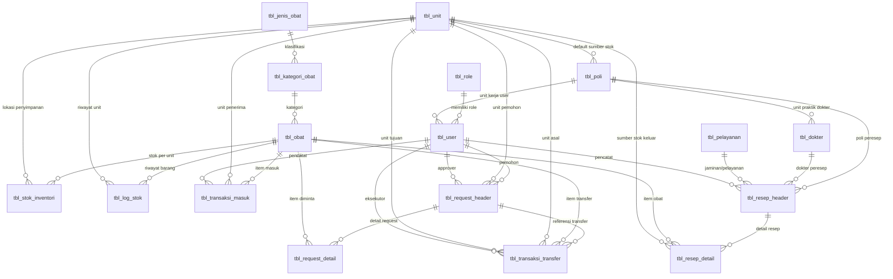

# 🏥 SYSTEM PROMPT & ARCHITECTURE SPECIFICATION: SIVO PUSKESMAS
> **Dokumentasi Lengkap Konteks Proyek untuk Asisten AI (ChatGPT / Claude / Gemini / Copilot)**  
> *Gunakan dokumen ini sebagai panduan konteks (system context) saat berdiskusi, mengembangkan fitur baru, refactoring, atau debugging sistem SIVO.*

---

## 📌 1. EXECUTIVE SUMMARY & IDENTITAS PROJEK

- **Nama Aplikasi:** SIVO Puskesmas (Sistem Informasi Inventori Obat Terpadu)
- **Instansi / Lokasi:** Puskesmas Wuluhan, Kabupaten Jember, Jawa Timur
- **Domain:** Manajemen Rantai Pasok Farmasi Fasilitas Kesehatan Tingkat Pertama (FKTP / Puskesmas)
- **Tujuan Utama:**
  1. Sentralisasi pencatatan stok obat keluar-masuk antar gudang induk, apotek, dan sub-unit pelayanan.
  2. Distribusi obat berjenjang (*two-tier distribution*) dengan pelacakan pemenuhan parsial (*partial delivery tracking*).
  3. Pelayanan resep pasien rawat jalan maupun rawat inap dengan pencatatan indikator sasaran mutu pelayanan klinis.
  4. Pencatatan *immutable audit trail* (kartu stok elektronik) untuk seluruh pergerakan barang medis.
  5. Penyusunan laporan otomatis periodik (Harian, Bulanan / LPLPO, Mutasi Sub-Unit, Kunjungan Pasien, dan Sasaran Mutu) berformat Print/PDF dan Excel.

---

## 🛠️ 2. TECH STACK & ARSITEKTUR SISTEM

### 2.1 Backend
- **Bahasa & Versi:** PHP Native (Kompatibel PHP 8.0 - 8.2+)
- **Database Driver:** PHP Data Objects (PDO) dengan mode Prepared Statements kaku (`PDO::ATTR_EMULATE_PREPARES => false`, `PDO::ATTR_ERRMODE => PDO::ERRMODE_EXCEPTION`)
- **Keamanan Transaksi:** Database Transaction Locking (`$pdo->beginTransaction()`, `$pdo->commit()`, `$pdo->rollBack()`, serta query penguncian baris `SELECT ... FOR UPDATE` untuk mencegah *race condition* stok obat)
- **Autentikasi & Enkripsi:** PHP Session dengan `session_regenerate_id(true)`, hashing kata sandi menggunakan `password_hash()` algoritma Bcrypt (`PASSWORD_BCRYPT`), serta pengecekan otorisasi di setiap file via `templates/auth_check.php`

### 2.2 Database
- **RDBMS:** MySQL / MariaDB (Engine: **InnoDB** untuk integritas relasi Foreign Key)
- **Collation:** `utf8mb4_general_ci`
- **Nama Database Default:** `dbpuskesmas` (Lokal) / `if0_42295308_dbpuskesmas` (Produksi)

### 2.3 Frontend & UI
- **Framework UI:** Bootstrap 4 (Template: SB Admin 2)
- **Icons:** FontAwesome 5 Free
- **Scripting & DOM:** Vanilla JavaScript & jQuery 3.x
- **Komponen Interaktif:**
  - **DataTables:** Pengurutan, pencarian, dan pagination tabel
  - **SweetAlert2:** Notifikasi popup modal untuk alert sukses/gagal/konfirmasi hapus
  - **Dynamic Rows DOM:** Script penambahan dan penghapusan baris dinamis pada form Request Stok dan Resep

### 2.4 Reporting Engine
- **Cetak Dokumen:** Native HTML Print Styling (`@media print`, `@page { size: landscape; margin: 1cm; }`, `window.print()`)
- **Ekspor Excel:** HTML Table Spreadsheet format MIME (`application/vnd-ms-excel` / `.xls`)

### 2.5 Deployment & Lingkungan
Arsitektur proyek dirancang secara **Monorepo Hybrid**:
1. **Frontend / SEO Landing Page (Vercel):**
   - File `index.html` dan `og-image.png` statis di root repositori dideploy ke Vercel (`https://sivo-wuluhan.vercel.app`).
   - Menyediakan tampilan landing page Glassmorphism interaktif, metadata Open Graph lengkap (WhatsApp, Facebook, Twitter Cards), dan JSON-LD Schema.org untuk kebutuhan indexing Google & preview link sosial media.
2. **Backend Application Server (InfinityFree / XAMPP):**
   - Berjalan di server PHP + Apache / cPanel (`https://sivo-wuluhan.page.gd/`).
   - File `config.php` mendeteksi host secara cerdas (`$_SERVER['HTTP_HOST']`) untuk beralih otomatis antara database lokal XAMPP (`127.0.0.1`, user `root`, no password, BASE_URL `/puskesmas/`) dan server produksi InfinityFree.

---

## 👥 3. ROLE-BASED ACCESS CONTROL (RBAC) & ACTOR MATRIX

Sistem memiliki **5 Peran Pengguna (Role)** yang terdefinisi ketat:

| Role ID | Nama Role | Deskripsi Wewenang & Akses Halaman |
| :--- | :--- | :--- |
| **1** | **Super Admin** | • Akses mutlak ke seluruh sistem.<br>• Kelola Akun User (`master/data_user.php`)<br>• Kelola Data Poli (`master/data_poli.php`) & Unit (`master/data_unit.php`)<br>• Kelola Jenis Pelayanan (`master/data_pelayanan.php`) & Konfigurasi (`master/konfigurasi.php`)<br>• Persetujuan Request Apotek → Gudang (`request/kelola_gudang.php`)<br>• Monitoring semua riwayat dan seluruh laporan eksekutif. |
| **2** | **Admin (Operator Gudang)** | • Petugas Gudang Farmasi Induk.<br>• Kelola Master Obat & Auto-kode (`master/data_obat.php`)<br>• Kelola Master Dokter (`master/data_dokter.php`)<br>• Penerimaan Stok dari Vendor/Dinkes (`stok/terima.php`)<br>• Transfer Stok Internal antar Unit (`stok/transfer.php`)<br>• Stok Opname Gudang (`stok/opname.php`)<br>• Persetujuan Request Apotek → Gudang (`request/kelola_gudang.php`)<br>• Akses seluruh laporan inventori & sasaran mutu. |
| **3** | **Poli Depan** | • Unit Rawat Jalan (Poli Umum, KIA-KB, Gigi, MTBS, HIV, TBC).<br>• **Viewer Pasif**: Hanya bisa memantau sisa stok fisik di **Apotek** (`stok/lihat.php`) agar dokter/perawat mengetahui ketersediaan obat sebelum menulis resep manual. |
| **4** | **Poli Belakang** | • Unit Tindakan / Rawat Inap / Kegawatdaruratan (UGD, KB Poned, Rawat Inap).<br>• Memiliki stok obat mandiri di sub-unit.<br>• Memantau stok internal sub-unit sendiri (`stok/lihat.php`).<br>• Input Pemakaian Obat / Resep pasien langsung (`resep/tambah.php`, `resep/history.php`, `resep/edit.php`).<br>• Membuat Request Pasokan Obat ke Apotek (`request/buat.php`).<br>• Laporan Keluar Masuk Sub-unit (`laporan/keluar_masuk_polibelakang.php`). |
| **5** | **Apotek** | • Instalasi Farmasi Pelayanan.<br>• Memantau & Opname stok Apotek (`stok/lihat.php`, `stok/opname.php`).<br>• Transfer stok eceran internal (`stok/transfer.php`).<br>• Menerima, memeriksa, dan menyetujui request dari Poli Belakang (`request/kelola.php`, `proses_setujui.php`) dengan skema pengiriman penuh atau parsial.<br>• Membuat request pasokan obat skala besar ke Gudang Induk (`request/buat_apotek.php`).<br>• Mengakses seluruh laporan operasional farmasi. |

---

## 🗄️ 4. STRUKTUR DATABASE & ENTITY RELATIONSHIP (ERD)

Database terdiri dari **18 Tabel Utama**:



### Kamus Data & Spesifikasi Tabel

1. **`tbl_role`**: Menyimpan daftar level otorisasi pengguna.
   - `id_role` (INT, PK, AI)
   - `nama_role` (VARCHAR 50, UNIQUE): `Super Admin`, `Admin (Operator)`, `Poli Depan`, `Poli Belakang`, `Apotek`
   - `deskripsi_role` (VARCHAR 255)

2. **`tbl_unit`**: Lokasi fisik/gudang penyimpanan stok obat.
   - `id_unit` (INT, PK, AI): `1: GUDANG`, `2: APOTEK`, `3: UGD`, `4: KB PONED`, `5: RAWAT INAP`
   - `nama_unit` (VARCHAR 50, UNIQUE)

3. **`tbl_poli`**: Data unit poli pelayanan klinis.
   - `id_poli` (INT, PK, AI)
   - `id_unit_stok_default` (INT, FK -> `tbl_unit.id_unit`): *Kunci Relasi Penting!* Menentukan dari mana stok obat dikurangkan saat poli ini meresepkan. (Poli 1 s.d. 6 -> Apotek unit 2; UGD 7 -> UGD unit 3; Poned 8 -> Poned unit 4; Rawat Inap 9 -> Rawat Inap unit 5).
   - `nama_poli` (VARCHAR 100, UNIQUE)

4. **`tbl_user`**: Data akun pengguna sistem.
   - `id_user` (INT, PK, AI)
   - `id_role` (INT, FK -> `tbl_role.id_role`)
   - `id_poli` (INT, NULLABLE, FK -> `tbl_poli.id_poli`): Wajib untuk role Poli (3 & 4), NULL untuk Super Admin (1), Admin (2), dan Apotek (5).
   - `username` (VARCHAR 50, UNIQUE)
   - `password` (VARCHAR 255, Bcrypt hash)
   - `nama_lengkap` (VARCHAR 100)
   - `is_active` (TINYINT 1, DEFAULT 1)

5. **`tbl_jenis_obat`**: Klasifikasi sumber pengadaan anggaran obat.
   - `id_jenis_obat` (INT, PK, AI)
   - `nama_jenis_obat` (VARCHAR 50, UNIQUE): `IFK` (Instalasi Farmasi Kabupaten / Drop Dinkes) dan `BLUD` (Pengadaan Mandiri BLUD).

6. **`tbl_kategori_obat`**: Sub-kategori obat/bahan medis habis pakai.
   - `id_kategori_obat` (INT, PK, AI)
   - `id_jenis_obat` (INT, FK -> `tbl_jenis_obat.id_jenis_obat`)
   - `nama_kategori` (VARCHAR 100): e.g. `UMUM`, `PROGRAM OBAT ARV`, `PROGRAM IMUNISASI`, `REAGENT`, `BAHAN HABIS PAKAI GIGI`, `BHP`, `BELANJA BAHAN KIMIA`.

7. **`tbl_obat`**: Master katalog item obat & BHP.
   - `id_obat` (INT, PK, AI)
   - `kode_obat` (VARCHAR 20, UNIQUE): Format otomatis sequential seperti `IFK-0001` atau `BLUD-0001`.
   - `nama_obat` (VARCHAR 255)
   - `satuan` (VARCHAR 30): e.g. `tablet`, `botol`, `ampul`, `vial`, `tube`, `kaplet`, `pcs`.
   - `id_kategori_obat` (INT, FK -> `tbl_kategori_obat.id_kategori_obat`)

8. **`tbl_dokter`**: Master data dokter peresep.
   - `id_dokter` (INT, PK, AI)
   - `nama_dokter` (VARCHAR 100, UNIQUE)
   - `id_poli` (INT, NULLABLE, FK -> `tbl_poli.id_poli`)

9. **`tbl_pelayanan`**: Golongan pembiayaan/jaminan pasien.
   - `id_pelayanan` (INT, PK, AI)
   - `jenis_pelayanan` (VARCHAR 50, UNIQUE): `UMUM`, `BPJS`

10. **`tbl_stok_inventori`**: Saldo stok fisik aktual per obat di setiap unit.
    - `id_stok` (INT, PK, AI)
    - `id_obat` (INT, FK -> `tbl_obat.id_obat`)
    - `id_unit` (INT, FK -> `tbl_unit.id_unit`)
    - `stok_akhir` (INT, DEFAULT 0)
    - `stok_minimum` (INT, DEFAULT 10): Ambang batas kritis peringatan stok menipis.
    - `updated_at` (DATETIME, CURRENT_TIMESTAMP ON UPDATE)
    - *Constraint:* `UNIQUE KEY (id_obat, id_unit)` memastikan tidak ada duplikasi data saldo obat pada unit yang sama.

11. **`tbl_log_stok`**: Catatan riwayat mutasi buku besar / kartu stok elektronik (*immutable ledger*).
    - `id_log` (BIGINT, PK, AI)
    - `tgl_log` (DATETIME)
    - `id_obat` (INT, FK -> `tbl_obat.id_obat`)
    - `id_unit` (INT, FK -> `tbl_unit.id_unit`)
    - `sumber_data` (ENUM): `'Penerimaan'`, `'Transfer'`, `'Resep'`, `'Stok Opname'`, `'Manual'`
    - `stok_sebelum` (INT)
    - `masuk` (INT, DEFAULT 0)
    - `keluar` (INT, DEFAULT 0)
    - `stok_sesudah` (INT)
    - `keterangan` (VARCHAR 255)
    - `id_referensi_transaksi` (BIGINT, NULLABLE)

12. **`tbl_transaksi_masuk`**: Dokumen penerimaan stok dari vendor luar/Dinkes.
    - `id_masuk` (BIGINT, PK, AI)
    - `tgl_masuk` (DATETIME)
    - `id_obat` (INT, FK -> `tbl_obat.id_obat`)
    - `id_unit` (INT, FK -> `tbl_unit.id_unit`)
    - `jumlah_masuk` (INT)
    - `id_user_pencatat` (INT, FK -> `tbl_user.id_user`)
    - `keterangan` (VARCHAR 255): Nomor faktur / asal suplai.

13. **`tbl_request_header`**: Dokumen permintaan pasokan obat antar-unit.
    - `id_request` (BIGINT, PK, AI)
    - `tgl_request` (DATETIME)
    - `id_user_request` (INT, FK -> `tbl_user.id_user`)
    - `id_unit_tujuan` (INT, FK -> `tbl_unit.id_unit`): Unit pemohon yang menerima barang.
    - `tipe_request` (VARCHAR 50): `'Poli_ke_Apotek'` atau `'Apotek_ke_Gudang'`
    - `status` (ENUM): `'Pending'`, `'Partial'`, `'Completed'`, `'Cancelled'`
    - `keterangan_request` (VARCHAR 255)
    - `id_user_approve` (INT, NULLABLE, FK -> `tbl_user.id_user`)
    - `tgl_approve` (DATETIME, NULLABLE)

14. **`tbl_request_detail`**: Item obat dan kuantitas dalam dokumen permintaan.
    - `id_request_detail` (BIGINT, PK, AI)
    - `id_request` (BIGINT, FK -> `tbl_request_header.id_request`)
    - `id_obat` (INT, FK -> `tbl_obat.id_obat`)
    - `jumlah_request` (INT)
    - `jumlah_terpenuhi` (INT, DEFAULT 0): Melacak progres pengiriman bertahap (parsial).

15. **`tbl_transaksi_transfer`**: Bukti fisik perpindahan obat antar-unit.
    - `id_transfer` (BIGINT, PK, AI)
    - `id_request` (BIGINT, NULLABLE, FK -> `tbl_request_header.id_request`)
    - `tgl_transfer` (DATETIME)
    - `id_obat` (INT, FK -> `tbl_obat.id_obat`)
    - `id_unit_asal` (INT, FK -> `tbl_unit.id_unit`)
    - `id_unit_tujuan` (INT, FK -> `tbl_unit.id_unit`)
    - `jumlah` (INT)
    - `id_user_pencatat` (INT, FK -> `tbl_user.id_user`)
    - `keterangan` (VARCHAR 255)

16. **`tbl_resep_header`**: Header lembar resep/pemakaian obat kepada pasien.
    - `id_resep` (BIGINT, PK, AI)
    - `tgl_resep` (DATETIME)
    - `nama_pasien` (VARCHAR 150)
    - `id_poli` (INT, FK -> `tbl_poli.id_poli`)
    - `id_dokter` (INT, NULLABLE, FK -> `tbl_dokter.id_dokter`)
    - `id_pelayanan` (INT, FK -> `tbl_pelayanan.id_pelayanan`): Umum / BPJS
    - `id_user_pencatat` (INT, FK -> `tbl_user.id_user`)
    - `kelengkapan_resep` (ENUM): `'Lengkap'`, `'Tidak Lengkap'` (Indikator Mutu)
    - `kesalahan_resep` (ENUM): `'Ada'`, `'Tidak Ada'` (Indikator Keselamatan Pasien)
    - `sesuai_formularium` (ENUM): `'Sesuai'`, `'Tidak Sesuai'` (Indikator Kepatuhan Obat Nasional/Daerah)

17. **`tbl_resep_detail`**: Baris rincian obat yang diberikan pada resep.
    - `id_resep_detail` (BIGINT, PK, AI)
    - `id_resep` (BIGINT, FK -> `tbl_resep_header.id_resep`)
    - `id_obat` (INT, FK -> `tbl_obat.id_obat`)
    - `id_unit_asal` (INT, FK -> `tbl_unit.id_unit`): Unit yang stoknya dipotong.
    - `jumlah_keluar` (INT)
    - `jenis_racikan` (ENUM): `'Racikan'`, `'Non Racikan'`

18. **`tbl_konfigurasi`**: Pengaturan global instansi (Nama Kepala Puskesmas, NIP, Nama PJ Farmasi, Logo).
    - `id_konfig` (INT, PK, AI)
    - `setting_key` (VARCHAR 50, UNIQUE)
    - `setting_value` (TEXT)

---

## 🔄 5. ALUR KERJA BISNIS & USER FLOW SISTEM (SYSTEM FLOWS)

### 5.1 Alur Rantai Pasok Utama (Supply Chain Flow)
```
[VENDOR / DINKES JEMBER]
           │
           ▼ (Penerimaan Stok: stok/terima.php)
    [GUDANG INDUK] (id_unit: 1)
           │
           ▼ (Request Apotek ke Gudang -> Disetujui Admin: request/proses_setujui_gudang.php)
      [APOTEK] (id_unit: 2)
     ┌─────┴────────────────────────────────┐
     ▼                                      ▼
(Pelayanan Resep Pasien)    (Request Poli Belakang ke Apotek -> Disetujui Apotek:
(Poli Depan: Umum, KIA, dsb) request/proses_setujui.php [Full / Partial])
                                            │
                                            ▼
                             [SUB-UNIT / POLI BELAKANG]
                             • UGD (id_unit: 3)
                             • KB PONED (id_unit: 4)
                             • RAWAT INAP (id_unit: 5)
                                            │
                                            ▼ (Input Pemakaian Resep: resep/tambah.php)
                                         [PASIEN]
```

---

### 5.2 Flow 1: Penerimaan Obat Masuk (Stock-In)
1. **Aktor:** Admin Operator (Role 2) / Super Admin (Role 1).
2. **Halaman:** `stok/terima.php` -> `stok/proses_terima.php`.
3. **Mekanisme Eksekusi:**
   - Memilih obat, unit penerima (biasanya Gudang id:1), jumlah masuk, tanggal, dan no faktur/keterangan.
   - Membuka transaksi database (`beginTransaction`).
   - `INSERT INTO tbl_transaksi_masuk`.
   - Cek `tbl_stok_inventori`: jika sudah ada record `(id_obat, id_unit)` lakukan `UPDATE stok_akhir = stok_akhir + jumlah`; jika belum ada lakukan `INSERT`.
   - `INSERT INTO tbl_log_stok` dengan flag `sumber_data = 'Penerimaan'`.
   - `commit()`.

---

### 5.3 Flow 2: Permintaan Obat Berjenjang & Pengiriman Parsial (Two-Tier Request & Partial Delivery)

#### Kasus A: Poli Belakang (UGD / Poned / Rawat Inap) meminta obat ke Apotek
1. **Pembuatan Request (`request/buat.php` -> `proses_buat.php`):**
   - User Poli Belakang (Role 4) memilih daftar obat dan jumlah yang dibutuhkan.
   - Header disimpan dengan `tipe_request = 'Poli_ke_Apotek'` dan `status = 'Pending'`.
   - Detail disimpan di `tbl_request_detail` dengan `jumlah_terpenuhi = 0`.
2. **Pemeriksaan & Persetujuan Apotek (`request/kelola.php` -> `proses_setujui.php`):**
   - Petugas Apotek (Role 5) membuka request.
   - Sistem mengunci data stok Apotek (`id_unit = 2`) dengan query `FOR UPDATE`.
   - Sistem membandingkan sisa obat yang diminta (`sisa = jumlah_request - jumlah_terpenuhi`) dengan ketersediaan stok fisik di Apotek:
     - **Kasus Sempurna (Stok Cukup Semua):** Apotek mengirim 100% permintaan. Stok Apotek berkurang, stok Poli bertambah. `status` header berubah menjadi `'Completed'`.
     - **Kasus Parsial (Stok Apotek Hanya Ada Sebagian):** Apotek mengirimkan sejumlah stok yang ada (misal diminta 10, stok apotek hanya ada 6, dikirim 6). Kolom `jumlah_terpenuhi` bertambah jadi 6, sisa 4 tercatat sebagai hutang pasokan. `status` header menjadi `'Partial'`. Dashboard akan menampilkan alert bahaya merah (peringatan stok belum lunas). Tombol **"Kirim Sisa"** akan tetap tersedia untuk diselesaikan saat Apotek sudah restock dari Gudang.
     - **Kasus Kosong:** Bila seluruh stok obat yang diminta 0 di Apotek, status berubah menjadi `'Cancelled'`.
   - Setiap obat yang terkirim mencatat mutasi di `tbl_transaksi_transfer` dan 2 baris log di `tbl_log_stok` (1 keluar dari Apotek, 1 masuk ke Unit Poli).

#### Kasus B: Apotek meminta obat skala besar ke Gudang Induk
1. Petugas Apotek membuat request via `request/buat_apotek.php` -> `proses_buat_apotek.php` dengan `tipe_request = 'Apotek_ke_Gudang'`.
2. Admin Gudang (Role 1 / 2) memeriksa dan menyetujui di `request/kelola_gudang.php` -> `proses_setujui_gudang.php`.
3. Stok dipotong dari Gudang (`id_unit = 1`) dan ditambahkan ke Apotek (`id_unit = 2`).

---

### 5.4 Flow 3: Pelayanan Resep & Pengurangan Stok Otomatis
1. **Aktor:** Poli Belakang (Role 4) atau Operator Farmasi (Role 2).
2. **Halaman:** `resep/tambah.php` -> `resep/proses_tambah.php`.
3. **Mekanisme Otomatis:**
   - User memasukkan Tanggal, Nama Pasien, Poli Peresep, Nama Dokter, Jenis Pelayanan (Umum/BPJS), serta 3 indikator mutu farmasi (Kelengkapan, Kesalahan, Kesesuaian Formularium).
   - Memilih 1 atau lebih obat beserta jumlah dan kategori racikan/non-racikan.
   - **Deteksi Unit Asal Cerdas:** Sistem membaca `tbl_poli.id_unit_stok_default` berdasarkan `id_poli` yang dipilih.
     - Jika Poli Umum/Gigi -> unit asal otomatis **Apotek (2)**.
     - Jika UGD -> unit asal otomatis **UGD (3)**.
     - Jika KB Poned -> unit asal otomatis **KB Poned (4)**.
     - Jika Rawat Inap -> unit asal otomatis **Rawat Inap (5)**.
   - Validasi saldo: Stok tidak boleh kurang dari jumlah yang diresepkan. Jika kurang, transaksi di-rollback dan muncul SweetAlert penolakan.
   - Jika cukup: potong stok di unit terkait, catat `tbl_resep_header`, `tbl_resep_detail`, dan `tbl_log_stok` (`sumber_data = 'Resep'`).

---

### 5.5 Flow 4: Edit & Hapus Resep (Reconciliation & Rollback Stok)
- File: `resep/history.php`, `resep/edit.php`, `resep/proses_edit.php`, `resep/proses_hapus.php`.
- **Fitur Khusus:** Jika petugas salah menginputkan dosis, jumlah, atau jenis obat pada resep pasien yang sudah tersimpan:
  - Fitur **Edit Resep** akan secara matematis menghitung selisih kuantitas baru vs lama. Jika obat diganti, stok obat lama dikembalikan (*restore*) ke unit asal, dan stok obat baru dipotong.
  - Fitur **Hapus Resep** membatalkan seluruh pemakaian dan mengembalikan stok fisik obat ke unit asal secara otomatis dengan audit log.

---

### 5.6 Flow 5: Stok Opname & Penyesuaian Fisik (Stock Opname)
- File: `stok/opname.php` -> `stok/proses_opname.php`.
- Menyesuaikan perbedaan antara catatan sistem (*stok sistem*) dengan perhitungan riil di lemari obat (*stok fisik*).
- Sistem menghitung selisih (`selisih = fisik - sistem`).
- Jika fisik > sistem: dicatat sebagai mutasi `masuk`.
- Jika fisik < sistem: dicatat sebagai mutasi `keluar`.
- `tbl_log_stok` menandai transaksi dengan `sumber_data = 'Stok Opname'`.

---

### 5.7 Flow 6: Pelaporan & Indikator Mutu Farmasi
Modul `laporan/` menyediakan query analitik komprehensif:
1. **Laporan Harian (`laporan/harian.php`):** Rincian resep per hari, nama pasien, dokter, dan daftar obat yang dikeluarkan.
2. **Laporan Bulanan (`laporan/bulanan.php`):** Standar LPLPO (Laporan Pemakaian dan Lembar Permintaan Obat). Kolom: Stok Awal, Penerimaan, Pengeluaran per Poli, Rusak/ED, Sisa Stok Akhir.
3. **Laporan Semua Poli (`laporan/bulanan_poli.php`):** Matriks konsumsi obat lintas seluruh poli dalam periode satu bulan.
4. **Laporan Keluar-Masuk Sub-Unit (`laporan/keluar_masuk_polibelakang.php`):** Buku register khusus pergerakan obat di UGD, Poned, dan Rawat Inap.
5. **Laporan Kunjungan (`laporan/kunjungan.php`):** Statistik jumlah lembar resep dan pasien berdasarkan jenis jaminan (Umum vs BPJS).
6. **Laporan Sasaran Mutu (`laporan/sasaran_mutu.php`):** Rekapitulasi persentase pemenuhan SPM (Standar Pelayanan Minimal) Farmasi:
   - Persentase Resep Lengkap (% R/ Lengkap)
   - Persentase Resep Tanpa Kesalahan (% R/ Zero Error)
   - Persentase Kepatuhan Formularium Nasional/Puskesmas (% Fornas)
7. **Ekspor File:** Seluruh laporan memiliki opsi **Cetak PDF (Print Layout)** via `laporan/export_pdf.php` dan **Ekspor Excel** via `laporan/export_excel.php`.

---

## 📁 6. PETA STRUKTUR DIREKTORI & FILE LENGKAP

```
puskesmas/
├── .diagram/                  # Aset arsitektur (Draw.io, ERD image, revisi.txt catatan lapangan)
├── assets/                    # Library statis vendor (Bootstrap 4, FontAwesome 5, jQuery, DataTables, SB Admin)
├── auth/                      # Modul Otentikasi
│   ├── login.php              # UI Formulir Login dengan background image & alert
│   ├── proses_login.php       # Verifikasi kredensial Bcrypt, session mapping, & role binding
│   └── logout.php             # Penghancuran sesi & redirect ke login
├── master/                    # Modul Master Data (Super Admin & Admin Gudang)
│   ├── data_obat.php          # CRUD Katalog Obat, Satuan, Kategori, & Filter Jenis (IFK/BLUD)
│   ├── data_dokter.php        # CRUD Data Dokter dan spesialisasi Poli
│   ├── data_user.php          # CRUD Akun Pengguna, penetapan Role & Poli kerja
│   ├── data_poli.php          # CRUD Unit Pelayanan Poli & penentuan Default Unit Stok
│   ├── data_unit.php          # CRUD Data Unit Penyimpanan Fisik (Gudang, Apotek, UGD, dll)
│   ├── data_pelayanan.php     # CRUD Kategori Jaminan (Umum, BPJS)
│   ├── konfigurasi.php        # Pengaturan Kop Surat, Pimpinan Puskesmas, NIP, PJ Farmasi
│   ├── get_kode_terakhir.php  # AJAX Endpoint: Auto-increment generator kode obat (IFK-xxxx/BLUD-xxxx)
│   ├── proses_crud_obat.php
│   ├── proses_crud_user.php
│   ├── proses_crud_poli.php
│   ├── proses_crud_unit.php
│   ├── proses_crud_pelayanan.php
│   ├── proses_konfigurasi.php
│   └── proses_tambah_dokter.php
├── stok/                      # Modul Manajemen Stok Fisik
│   ├── lihat.php              # Visualisasi stok real-time, badge stok kritis, search & filter
│   ├── terima.php             # Form Penerimaan stok masuk dari Pemasok / Vendor / Dinkes
│   ├── proses_terima.php      # Controller eksekusi stok masuk + update saldo + log
│   ├── transfer.php           # Form Mutasi/Transfer stok manual antar unit
│   ├── proses_transfer.php    # Controller eksekusi transfer antar unit
│   ├── opname.php             # Form Rekonsiliasi / Stok Opname fisik
│   ├── proses_opname.php      # Controller hitung selisih fisik vs sistem
│   └── ajax_get_obat.php      # AJAX lookup data stok obat per unit
├── request/                   # Modul Permintaan Stok Obat Antar Unit (Two-Tier)
│   ├── buat.php               # Form request Poli Belakang ke Apotek (Role 4)
│   ├── proses_buat.php        # Controller pembuatan request Poli_ke_Apotek
│   ├── buat_apotek.php        # Form request Apotek ke Gudang Induk (Role 5)
│   ├── proses_buat_apotek.php # Controller pembuatan request Apotek_ke_Gudang
│   ├── kelola.php             # Antrean persetujuan request di Apotek (Role 5)
│   ├── kelola_gudang.php      # Antrean persetujuan request di Gudang (Role 1 & 2)
│   ├── detail.php             # View detail item request, tombol proses/kirim sisa
│   ├── proses_setujui.php     # Logic persetujuan penuh/parsial Poli Belakang oleh Apotek
│   ├── proses_setujui_gudang.php # Logic persetujuan penuh Apotek oleh Gudang
│   └── riwayat.php            # Riwayat lengkap seluruh dokumen request & pelacakan status
├── resep/                     # Modul Peresepan & Pengeluaran Obat ke Pasien
│   ├── tambah.php             # Form input resep pasien + indikator sasaran mutu klinis
│   ├── proses_tambah.php      # Eksekusi pemotongan stok sesuai unit asal poli + catat resep
│   ├── history.php            # Daftar riwayat resep yang pernah diinput
│   ├── edit.php               # Formulir koreksi data resep / obat
│   ├── proses_edit.php        # Perhitungan kompensasi stok lama vs baru
│   └── proses_hapus.php       # Rollback stok fisik obat dan hapus resep
├── laporan/                   # Modul Pelaporan & Sasaran Mutu
│   ├── harian.php             # Laporan pengeluaran harian
│   ├── bulanan.php            # Laporan rekap bulanan stok & pemakaian (format LPLPO)
│   ├── bulanan_poli.php       # Matriks pemakaian obat seluruh poli
│   ├── keluar_masuk_polibelakang.php # Buku register stok keluar-masuk UGD/Poned/Rawat Inap
│   ├── kartu_stok.php         # Kartu riwayat pergerakan individual 1 item obat
│   ├── kunjungan.php          # Laporan demografi kunjungan pasien per poli & jaminan
│   ├── sasaran_mutu.php       # Rekapitulasi % indikator mutu resep (Lengkap, Error-free, Fornas)
│   ├── export_pdf.php         # Script generator cetak dokumen / window.print layout
│   └── export_excel.php       # Script generator ekspor tabel spreadsheet (.xls)
├── templates/                 # Komponen Tata Letak (Layout Partials)
│   ├── header.php             # HTML head, CSS imports, Topbar navigation, Profil dropdown
│   ├── footer.php             # Script tags, modal logout, JS plugins
│   ├── sidebar.php            # Dynamic RBAC Sidebar navigation sesuai Role ID 1 - 5
│   └── auth_check.php         # Security gatekeeper: validasi $_SESSION['user_id']
├── config.php                 # Environment switcher (Local vs Production), koneksi PDO, session start
├── dashboard.php              # Dashboard analitik: Counter obat, akun, stok kritis, alert partial
├── dbpuskesmas.sql            # Skema DDL & Dummy Data MySQL lengkap
├── index.php                  # Entry point routing PHP (redirect ke dashboard / login)
├── index.html                 # (Vercel Frontend) SEO Landing Page Glassmorphism modern
├── og-image.png               # Ilustrasi thumbnail media sosial (1200x630px)
├── README.md                  # Dokumentasi publik GitHub repository
└── .gitignore                 # File yang dikecualikan dari Git
```

---

## 🔒 7. STANDAR REKAYASA & KEAMANAN SISTEM

1. **Pencegahan SQL Injection:** Seluruh query dinamis yang melibatkan input pengguna wajib menggunakan **PDO Prepared Statements** dengan parameter binding `?` atau `:named_param`.
2. **Atomic Transaction Handling:** Seluruh operasi yang mempengaruhi lebih dari 1 tabel (seperti pengurangan stok inventori + penulisan log buku besar + pencatatan transaksi) wajib berada di dalam blok `try { $pdo->beginTransaction(); ... $pdo->commit(); } catch (Exception $e) { $pdo->rollBack(); }`.
3. **Pencegahan Race Condition:** Pada file verifikasi saldo stok (`proses_setujui.php`, `proses_setujui_gudang.php`, `proses_tambah.php`), query pembacaan stok wajib menggunakan klausul `FOR UPDATE` untuk mengunci baris data di level database selama transaksi berlangsung.
4. **Validasi Role di Tingkat Controller:** Setiap script PHP controller di baris awal wajib memeriksa role session pengguna (tidak hanya bergantung pada navigasi UI sidebar).
5. **State Retention:** Form penginputan data resep dan request dirancang mempertahankan state input (seperti nama pasien dan pelayanan) saat terjadi reload/refresh agar efisiensi kerja petugas medis di poli tetap tinggi.

---

## 💡 8. PETUNJUK UNTUK ASISTEN AI (INSTRUCTIONS FOR RECEIVING AI)

Saat Anda (AI) menerima pertanyaan atau instruksi terkait proyek ini:
1. **Pahami Batasan Role:** Selalu verifikasi wewenang aktor (Role 1 hingga 5) sebelum menyarankan perbaikan alur atau membuat endpoint baru.
2. **Konsistensi PDO:** Jangan pernah menulis kode MySQL menggunakan ekstensi lama `mysqli_*` atau query string concatenation mentah. Gunakan instance `$pdo` yang sudah tersedia dari `config.php`.
3. **Pelihara Log Stok:** Setiap operasi yang menambah, mengurangi, memindahkan, atau mengoreksi `tbl_stok_inventori.stok_akhir` **HARUS** diiringi penulisan baris baru pada `tbl_log_stok` agar kartu stok tidak corrupt.
4. **Perhatikan Kunci Default Unit Stok:** Ingat bahwa Poli Depan (Poli 1-6) menyedot stok dari Apotek (`id_unit = 2`), sedangkan Poli Belakang (Poli 7-9) menyedot stok dari unit fisiknya masing-masing (`id_unit = 3, 4, 5`).
5. **Dukungan Partial Request:** Pertahankan logika `jumlah_terpenuhi` vs `jumlah_request` pada modul permintaan obat antar-unit.
